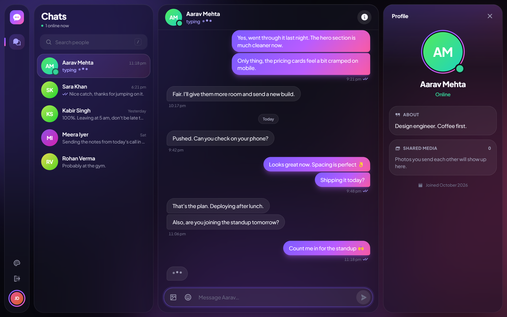
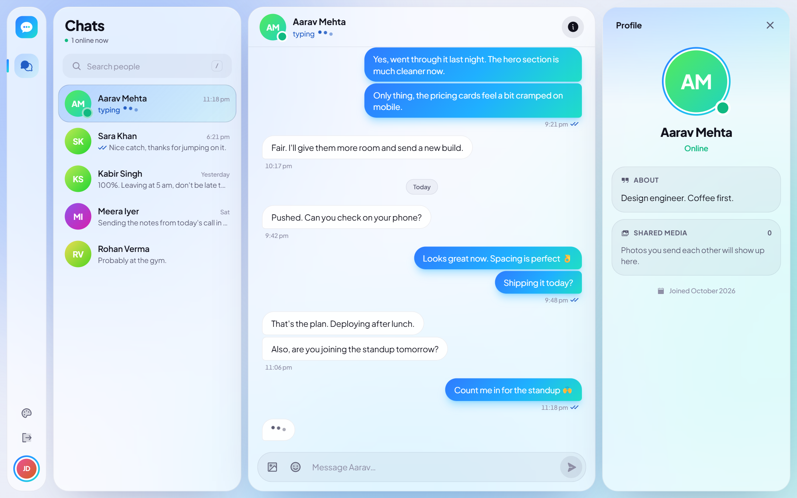
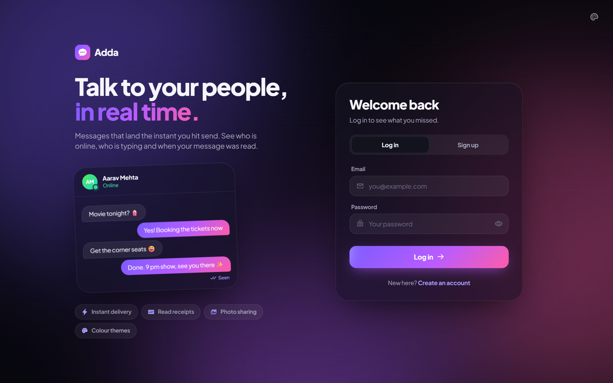
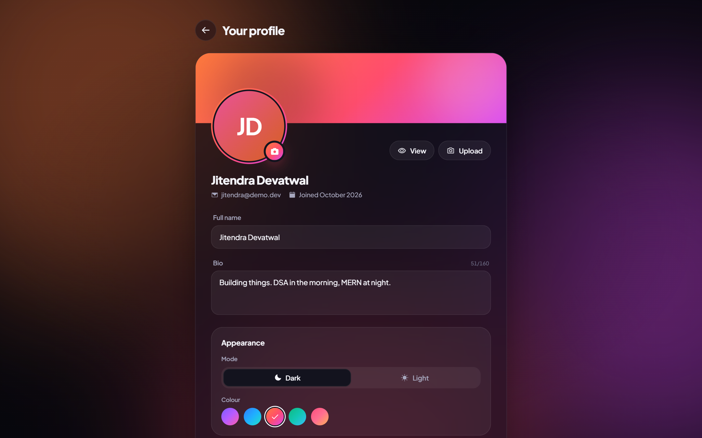

# Adda

A realtime one-to-one chat app. Messages arrive the moment they are sent, with typing indicators, read receipts, photos and live presence, in a glassy interface with five colour themes and a dark and a light mode.



| Light mode, Ocean colour | Login |
| --- | --- |
|  |  |



**Live:** https://chat-app-frontend-gamma-rust.vercel.app

This is the frontend. The API and realtime server live in [chatApp_backend](https://github.com/jitendra-devjit/chatApp_backend).

## Features

- Realtime messaging over Socket.IO, synced across every open tab
- Typing indicator and read receipts (sent and seen ticks)
- Reply to a message, react with an emoji, edit and delete for everyone
- Last seen, message sound and browser notifications
- Photo sharing with preview before sending, paste from clipboard and a full screen viewer
- Live online status, unread counts in the sidebar and in the browser tab
- Conversations sorted by latest message, with a preview of the last one
- Profile page with photo preview before saving, view, change and remove
- Five colour themes, each in dark and light mode
- Spring animations for messages, panels, menus and page changes
- Long histories load in pages as you scroll up, without losing your place
- Search with the `/` shortcut, `Enter` to send, `Shift + Enter` for a new line
- Fully responsive from phone to desktop

## Stack

React 19, Vite, Tailwind CSS 4, Motion, React Router, Socket.IO client, Axios.
Type is Plus Jakarta Sans. Icons are Phosphor.

## Run it

Start the backend first. Its demo mode needs no database or accounts:

```bash
# in chatApp_backend
npm install
npm run demo
```

Then the frontend:

```bash
npm install
npm run dev
```

Open http://localhost:5173 and log in with `jitendra@demo.dev` / `demo1234`. Open a second browser window with `aarav@demo.dev` to chat with yourself.

The backend address comes from `VITE_BACKEND_URL` in `.env` (default `http://localhost:5000`).

## Project layout

```
src/
  context/      auth and socket, chat state, theme
  components/   sidebar, conversation, composer, details panel, shared pieces
  pages/        home, login, profile
  lib/utils.js  dates, validation and small helpers
  index.css     design tokens for both themes
```
